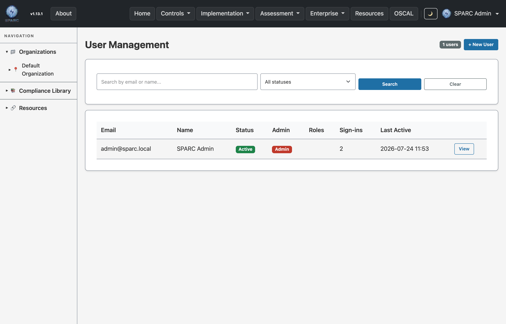
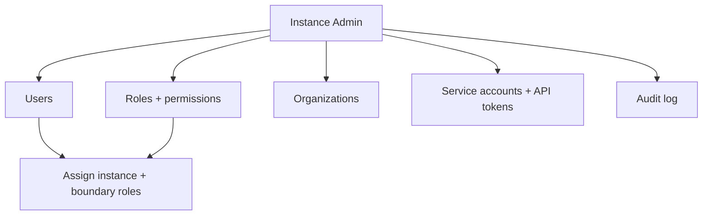
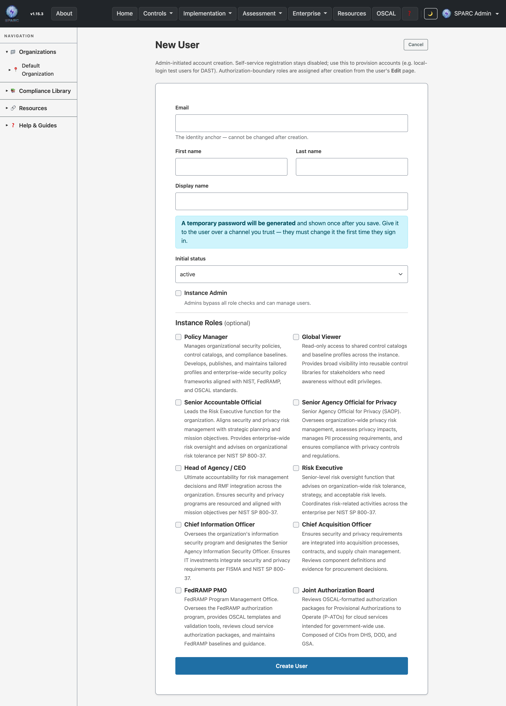

# User Guide: Administration

The **Administration** area is where Instance Admins manage people and
instance-wide settings: user accounts, roles and permissions, organizations,
service accounts and API tokens, the audit log, and deferred data migrations.
This guide covers the day-to-day admin tasks.

**Who this is for:** Instance Admins. Everything here lives under
*Administration* in the user menu and requires the Instance Admin role — see
[RBAC](RBAC) for the full permission model.

---

## Before you start

- **Access:** the **Instance Admin** role. The Administration submenu only
  appears in the user menu for Instance Admins.
- **Where to find it:** user menu (top right) → **Administration** → Users,
  Roles, Authorization Boundaries, Audit Log; plus Organizations and Service
  Accounts.

---

*Admin → Users: manage accounts, assign roles, and control account status.*

## At a glance

---

## Primary use cases

- **Manage people** — create/suspend users and assign their roles.
- **Define permissions** — create roles scoped to the instance or a boundary.
- **Enable automation** — issue service accounts and API tokens for the REST API.
- **Audit activity** — search and export the audit log.

---

## How to manage users

1. Go to **Administration → Users** (`/admin/users`).
2. Search or filter by status; the list is paginated (25 per page).
3. **View** a user (`/admin/users/:id`) to see their identities (local, OIDC,
   LDAP, GitHub, GitLab), assigned instance and boundary roles, and recent audit
   events.
4. **Edit** a user (`/admin/users/:id/edit`) to change their display name and
   **assign roles** — both instance roles and boundary-specific roles.
5. Use **Suspend** / **Reactivate** from the list to disable or restore an
   account.
6. If a user has lost their security key, open their profile and click **Reset
   security keys** to revoke all of their FIDO2 keys (the only recovery path —
   there are no self-service codes). They must then re-enroll. See
   [Security Keys & Smart Cards](User-Guide-Security-Keys).
7. If a user has **forgotten their password** (local login), open their profile
   and use one of the two recovery routes (v1.15.2):
   - **Issue temporary password** — works on any instance, including one with no
     outbound mail. The password is shown to you **once**; give it to the user
     over a channel you trust. They are required to choose a new password the
     moment they sign in, so the one you saw stops working immediately.
   - **Email reset link** — sends the user a single-use, expiring link. Only
     available when SMTP is configured.

   You never see or set the password the user ends up with. Issuing either one
   invalidates anything issued previously, and both are recorded in the audit
   log.

## How to create a user (v1.15.4)

1. Go to **Administration → Users** and click **New User** (`/admin/users/new`).
2. Fill in the email and name. **There is no password field** — you do not choose
   the new user's password.
3. Save. SPARC generates a **temporary password** and shows it once, in a panel on
   the new user's profile page.
4. **Copy it before you navigate away.** Only its encrypted digest is stored, so
   it cannot be shown again — if you lose it, issue a new one with **Issue
   temporary password** (above).
5. Give it to the user over a channel you trust. They must choose a new password
   the moment they sign in, so the one you saw stops working straight afterwards.

This closes a gap where an administrator typed a password the user was never
forced to replace — leaving a credential the administrator knew and that lasted
indefinitely. The account creation and the credential issuance are recorded as
separate audit events.

> **API callers:** `POST /api/v1/users` no longer accepts `password` /
> `password_confirmation`; a supplied value is ignored without error. The
> generated credential comes back once as `temporary_password`. See
> [API Reference](API-Reference).

## Administrators cannot be locked out (v1.15.4)

Two guards prevent an instance from losing all administrative access:

- **The last active administrator cannot be suspended or deactivated.** The
  attempt is refused with an explanation and recorded in the audit log. This
  applies everywhere — the admin screens, the API, and the automatic inactivity
  sweep. A deactivated account cannot sign in at all, and only *another*
  administrator can restore it, so there would be no way back in.
- **The break-glass administrator is exempt from inactivity deactivation and
  password expiry.** This is the single account named by `SPARC_ADMIN_EMAIL`,
  whose credential is rotated externally rather than by signing in. The exemption
  covers that one account only — named administrators are still deactivated when
  idle, and their passwords still expire.

If you renamed or replaced the break-glass account, update `SPARC_ADMIN_EMAIL` to
match. Left unset it defaults to `admin@sparc.local`, which would protect an
account you no longer use while leaving your real one exposed to the sweep. See
[Configuration](Configuration).

## How to create and assign roles

1. Go to **Administration → Roles** (`/admin/roles`).
2. Click **Create New** (`/admin/roles/new`).
3. Set the **name**, **display name**, and **scope** — *instance* or
   *authorization boundary*.
4. Tick the **permission checkboxes** (CRUD across document types and admin
   features).
5. Save. Open a role (`/admin/roles/:id`) to see its assigned users and full
   permission matrix. Assign the role to users from the user's Edit screen.

See [RBAC](RBAC) for how instance vs. boundary scope and the Instance Admin
bypass work.

## How to manage organizations

Go to **Administration → Organizations** (`/admin/organizations`) to create,
edit, and view organizations, and to add/remove members. Organizations are
**never hard-deleted** — use **Deactivate** / **Reactivate** instead, preserving
UUID-based audit traceability.

## How to issue service accounts and API tokens

1. Go to **Administration → Service Accounts** (`/admin/service_accounts`).
2. Create a service account — a non-interactive identity for automation. Its
   **email is a contact address**, not its identity: several accounts may share
   one team mailbox, and it may be a person's address.
3. Choose its **token expiry**. A service account's token must expire, at most
   `SPARC_API_TOKEN_MAX_DAYS` away (default 365); there is no "Never".
4. Choose **Allowed Endpoints**: **All endpoints**, or **Read** and/or **Write**
   per resource. Read covers fetching and the requests that only compute
   (previews, translations, analysis); Write covers everything that creates,
   changes or deletes.
5. The plaintext `sparc_sa_<token>` is shown **once** at creation (only a
   SHA-256 digest is stored), so copy it immediately.

Each token on the account page shows its status (**Active**, **Expires soon**
within 14 days, **Never expires**, **Expired**), its endpoint and CIDR limits,
and two buttons:

- **Renew** issues a new token with the same limits and lifetime. The old one
  keeps working for `SPARC_API_TOKEN_RENEWAL_GRACE_DAYS` (default 7) so the
  automation using it can switch over. Use it before a token expires.
- **Reissue** stops the token **now** and issues a replacement with the same
  limits. Use it when a token may be exposed.

**Regenerate Token** revokes every token on the account and issues one, keeping
the newest token's limits. A person's tokens are managed the same way from
their page under **Administration → Users**, where "Never" is still offered.

A token issued before v1.17.2 may never expire; the account page says so. It
keeps working — renew it to replace it with one that expires.

Service accounts authenticate the REST API and can bridge to a UI session via
`POST /api/v1/sessions/from_token`.

## How to use the audit log

1. Go to **Administration → Audit Log** (`/admin/audit_logs`).
2. Use the **filter panel** — free-text search, user, category, resource type,
   and a start/end **date range** — then **Filter** (or **Clear**).
3. The results table shows time, user, a colour-coded action badge, category,
   subject, and IP. Click **Details** for full event metadata
   (`/admin/audit_logs/:id`).
4. Click **Export CSV** to download the currently-filtered events.

## How to check data migrations

Go to **Administration → Data Migrations** (`/admin/data_migrations`) to confirm
that **deferred** migrations (which run post-boot via a background job) have
finished — each shows a state of pending, running, completed, or failed. Use
this after a deploy that included a long-running backfill.

**During a rolling deploy** (old and new containers running side by side), a
migration the new release added can show **failed** with the bare message
`Class … not loadable`. That is the *previous* release's container, which
cannot run code it has never seen; it is not a fault in the migration. From
v1.17.2 the new release picks such rows up again within **5 minutes** of the
old container draining, without a restart. A release from v1.17.2 onward,
running as the old container, leaves the row **pending** instead.

A failure that says more after the colon (for example
`not loadable: no migration file in this release`, or a Ruby error) is a real
one. It is retried once at the next boot, not every 5 minutes.

---

## Tips & best practices

- Assign roles at the **narrowest scope** that works — prefer a boundary role
  over an instance role unless the person truly operates instance-wide.
- **Copy the API token immediately** on creation; it can't be retrieved later,
  only renewed or reissued.
- **Renew a token before it expires**, not after: the renewal overlap only
  helps while the old token still works.
- Prefer **Suspend** over deletion for users and **Deactivate** for
  organizations — both preserve the audit trail.
- Use the audit log's **CSV export** with a date range for periodic access
  reviews and evidence gathering.

---

## Troubleshooting

| Symptom | Likely cause | What to do |
|---|---|---|
| No Administration menu | You aren't an Instance Admin | Only Instance Admins see it — request the role |
| A user can't access a boundary's docs | Role assigned at wrong scope | Assign the boundary-scoped role on the user's Edit screen |
| Lost an API token | Plaintext is shown only once | **Reissue** it: the lost one stops, and the new one keeps its limits |
| "Expires at is required for a service account's token" | "Never" or no expiry was asked for a service account | Pick a lifetime of at most `SPARC_API_TOKEN_MAX_DAYS` |
| "Choose the endpoints this token may reach" | Nothing was ticked in Allowed Endpoints | Tick **All endpoints**, or Read/Write for the resources it needs |
| Backfill seems incomplete after deploy | Deferred migration still running | Check Data Migrations for its state |
| A new migration shows failed: `Class … not loadable`, right after an upgrade | The previous release's container took it during a rolling deploy | Nothing to do: it re-runs within 5 minutes of the old container draining (v1.17.2+) |
| Audit export is huge | No filters applied | Narrow by date range/user before **Export CSV** |

---

## Related guides

- [User Guides index](User-Guides)
- [Getting Oriented](User-Guide-Getting-Oriented)
- [Authorization Boundaries](User-Guide-Authorization-Boundaries) — boundary-side
  membership.
- [RBAC](RBAC) — full role and permission model.
- [Screens & UI](Screens) — exhaustive element-level reference.
