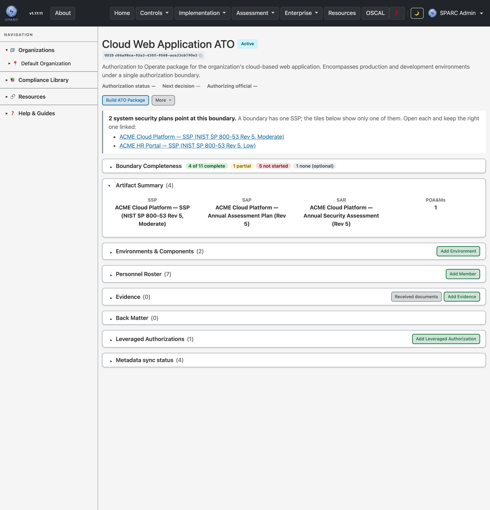
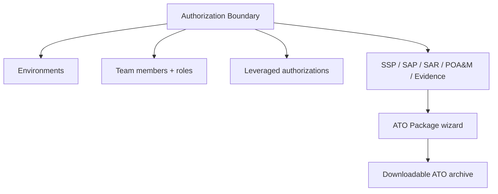
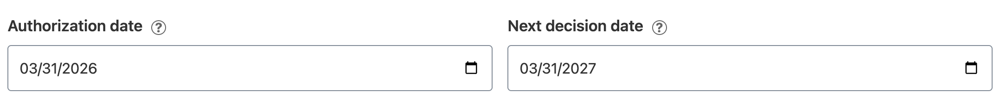
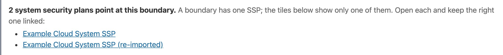

# User Guide: Authorization Boundaries

An **authorization boundary** represents the system you are getting authorized —
roughly one ATO. It is the hub that ties together your environments, team, and
all of the OSCAL documents (SSP, SAP, SAR, POA&M, evidence) for that system.
This guide covers creating and managing boundaries, their environments and
members, recording leveraged authorizations, and assembling an ATO package.

**Who this is for:** ISSOs, system owners, and anyone coordinating an
authorization. Creating and editing boundaries requires the appropriate role —
see [RBAC](RBAC). Instance Admins can also manage boundaries under
**Settings → Authorization boundaries** (see
[Administration](User-Guide-Administration)).

---

## Before you start

- **Access:** what you can do is decided per boundary:
  - **View** a boundary, open its ATO wizard and download its ATO package: `authorization_boundaries.read` on that boundary.
  - **Edit** it, attach documents and build its ATO package: `authorization_boundaries.write` on that boundary.
  - **Create** a boundary: an instance-wide write grant.
  - **Delete** one: an Instance Administrator.
- **Where to find it:** the **Boundaries** tab (`/authorization_boundaries`),
  the recently used **Boundaries** list on the **Overview**, or the **boundary
  switcher** — the small arrow beside the organization name in the header. The
  switcher lists every boundary you can reach, grouped by organization with your
  recently used ones first; type to narrow it. The list, the switcher and the tab's count show only the
  boundaries you may view. An administrator, or someone with an instance-wide read grant such
  as Global Viewer, sees every boundary. Everyone else sees the boundaries they
  hold a role on.
- **What you see is what you may do:** buttons and links on the boundary page
  appear only for actions you are permitted to take. A missing **Edit** or
  **Add Member** means your role does not include it, not that it is broken.
- **Completeness:** the *Personnel and roles* row counts everyone with access,
  whether given a role by an administrator or added through the boundary's
  roster.
  *Leveraged authorizations* with none recorded reads **None (optional)**: a
  system may inherit nothing, so it is not counted as not started.

---

*An Authorization Boundary / ATO package — environments, personnel roster, artifacts, and document metadata sync.*

## At a glance

---

## Moving around inside a boundary

When you open a boundary, the tab bar under the header becomes the boundary's
own, and the header's breadcrumb shows the organization and the boundary name:

**Overview** (the boundary page described below) · **Baseline** (when the
boundary has one) · **SSP** · **CDEFs** · **SAPs** · **SARs** · **Evidence** ·
**POA&Ms** · **Leveraged POA&Ms**

Each tab opens that list narrowed to this boundary. While you are inside a
boundary, the header's **Create** menu is headed **Create in** and the
boundary's name, and a new SSP, SAP, SAR, Evidence record or POA&M started
from it has this boundary already chosen. To jump to another boundary, use the
**boundary switcher** (the arrow beside the boundary name in the header): on a
list it keeps you on the same list, narrowed to the boundary you pick; anywhere
else it opens that boundary's page. **All boundaries** at the top of the
switcher takes you back out.

## Reading the boundary page

The page header shows the boundary's **name**, its **status** and its **UUID**.
**Build ATO Package** is the main button. Everything else is under **More**:
**Findings Triage**, **CDEF Coverage**, **Download ATO Package** (once documents
are attached), **Edit**, **Delete** and **All Authorization Boundaries**.

Under the header, the main column shows:

- **Latest activity** — the newest recorded change to the boundary or its
  documents.
- **Documents** — one row each for the Baseline, SSP, CDEFs, SAP, SAR, POA&Ms
  and leveraged systems, with its name or count, status and when it last
  changed. A row reading **Add…** means no document of that type is attached
  yet (see [How to attach a document](#how-to-attach-a-document-to-this-boundary)).
- **Activity** — a bar chart of changes, week by week.
- **Readiness** — the Boundary Completeness checklist as one bar, such as
  *3 of 11 complete*, with a **See each item** link down to the checklist.

The **About** column beside it holds the description and the ATO facts —
**Authorization status**, **Next decision** (amber when it is within 90 days,
red once it has passed), **Authorizing official**, **ISSO** and **People** —
tags for the impact level and baseline, and **Needs attention**: overdue
POA&M items, baseline controls without evidence, and how many SSP responses
are answered.

Below that, each section can be collapsed, and its header shows a count, for
example *Personnel Roster (4)*, so the page stays readable with everything
closed:

1. **Boundary Completeness** — open while the boundary is **Draft**, collapsed
   once it is Active, Authorized or Deauthorized. Its header summarises the
   checklist, such as *3 of 11 complete*.
2. **Environments & Components**
3. **Personnel Roster**
4. **Evidence** (called *Artifacts* before v1.17.2)
5. **Back Matter** — the boundary's own documents; see below.
6. **Leveraged Authorizations**
7. **Metadata sync status**

SPARC remembers which sections you open or close, in this browser, and applies
that choice on every boundary's page. A Draft boundary always opens Boundary
Completeness, because that is what a team building one needs in view.

### Working through Boundary Completeness

Each row's title is a link to where that item is done in SPARC: *Personnel and
roles* opens **Add Member**, *Profile / baseline* opens the boundary's **Edit**
page, *Evidence* opens **Add Evidence**, *Scan results* opens **Findings Triage**,
*Back-matter documents* opens the **Back Matter** section on this page, and so
on. Until the boundary has an SSP, the rows that are worked on the SSP
(categorization, components) link to **Add SSP first** instead. A row whose
title is plain text is one you do not have permission to work on. The small
**Guide** link beside each row opens the matching section of
[Adopting OSCAL](Adopting-OSCAL).

---

## Primary use cases

- **Stand up a new system for authorization** — create the boundary, define its
  environments, and add the team.
- **Record inherited controls** from a leveraged system (e.g. a FedRAMP-authorized
  cloud service) via a leveraged authorization.
- **Assemble an ATO package** — bundle the boundary's SSP/SAP/SAR/POA&M and
  evidence into a single downloadable archive for submission.

---

## How to create an authorization boundary

1. Choose **Create → Boundary** in the header, or open the **Boundaries** tab
   (`/authorization_boundaries`) and click **New Authorization Boundary**.
2. Enter a **name** and **description** for the system.
3. Save. You land on the boundary **detail** page — its **Overview** tab — the
   home base for this system.

On the boundary's **Edit** page you can also record the **Authorization date**
(when the ATO was granted) and the **Next decision date** (when the next
authorization decision is due). Both are dates (`YYYY-MM-DD`); leave one blank to
clear it. The next decision date travels with the SSP when it is exported, and the
authorization date is included in the boundary's HDF system document.

### FedRAMP

FedRAMP is something a boundary turns on (v1.17.11, #1390). Open the
**FedRAMP** section of the **Edit** page and tick **FedRAMP applies to this
system**. Until you do, the boundary shows no FedRAMP features: no FedRAMP page,
no FedRAMP card or evaluation column on its Amendments page, and no FedRAMP
documents in its exchange index. Turning it off again hides them without
removing anything. (A boundary that already used FedRAMP before v1.17.11 is
turned on by the upgrade.)

**Certification profile.** Choose the **Certification type** (20x or Rev5),
**Path** (Program or Agency) and **Class** (A–D). Together they decide which
FedRAMP rules apply. FedRAMP offers Class A only as a 20x Program
certification, and the Agency path only for Rev5; SPARC refuses other
combinations.

**Package overview.** The rest of the section holds what SPARC needs to write
this system's FedRAMP Certification Package Overview, and the address FedRAMP's
reports name for it (#1354, #1390).

- **Overview address in FedRAMP reports.** Choose **The address below**
  (normally your trust center, which FedRAMP requires) and enter the
  **FedRAMP package overview address**, an `https://` address. Or choose
  **SPARC's own overview endpoint**; the page shows its address. That choice
  needs `SPARC_APP_URL` to be an `https://` address, and readers of that
  endpoint need a SPARC token, so it does not by itself meet FedRAMP's trust
  center rules.
- **Service identification** and **Service properties**: the FedRAMP ID,
  provider, service name, acronym and description, certification type,
  website, logo address, service model and deployment model are required
  (marked *). The UEI number, business categories and next ongoing
  certification report date are optional. The lists offer only the values
  FedRAMP's schema allows.
- **Trust center** (optional): its address and description, whether readers
  must sign in, and, if they must, how to request access.
- **Contacts**: the provider's contacts as FedRAMP should list them. Use
  **+ Add contact** for each one. They need no SPARC account. The overview
  needs a **Security** and a **Sales** contact.

Once every required field and both contacts are saved, the boundary's
**Amendments** page offers **Download Certification Package Overview** (see
[HDF Amendment Triage](User-Guide-HDF-Amendment-Triage)). Until then, it lists
what is missing.

### The FedRAMP page

With FedRAMP on, the boundary's **More** menu opens **FedRAMP**: the system's
answer to each FedRAMP rule and Key Security Indicator, which its Security
Decision Record carries.

- **FedRAMP rules** lists every rule that applies to the certification profile,
  grouped by rule family, each with its force (MUST, SHOULD, MAY, …). Where a
  rule's wording differs by class, you see your class's. For Class A, the rules
  FedRAMP lists for it as mandatory, recommended and optional are included,
  with that force. Until the profile is complete, the tab asks you to set it.
- **Key Security Indicators** lists all of them, with the NIST SP 800-53
  controls each relates to. A 20x Security Decision Record requires them; a
  Rev5 system may record them too.
- Open a rule or KSI to record its **Status** (Implemented, Partially
  Implemented, Not Implemented) and how it is implemented, validated and
  verified. A KSI also takes its tests (one per line) and evidence entries
  (**+ Add evidence**).
- The counts show how many are answered, by status. The **Security Decision
  Record version** counts up with every change.
- The **Security Decision Record** card downloads the record, written from these
  answers and from the SSP's controls, parameters, ports and protocols (FedRAMP's
  assigned parameter values fill any the SSP leaves unset, for Rev5). It needs
  the overview address. Beside it, SPARC lists what FedRAMP still requires: the
  rules not yet answered, the KSIs for 20x, the Rev5 baseline controls missing
  from the SSP, and ports and protocols. Record ports and protocols on the SSP's
  components; OSCAL needs them there anyway.
- Viewing needs `evidence.read` on the boundary; recording needs
  `evidence.write`. Each change is audited.

#### Significant changes

The **Significant changes** tab keeps the record FedRAMP requires of every
change you evaluate (SCN-CSO-EVA, SCN-CSO-MAR).

- **Record a change**: its **Type**, a short description and why it is that
  type, then what a notification carries: reason, customer impact, new risks,
  the impact analysis, the impacted KSIs or controls, assessor, related
  vulnerability, approver, and the plan (summary, planned start and
  completion, milestones). Tick **Made during an emergency** when you made it
  first and notify afterwards (SCN-CSO-EMG).
- A **Routine** recurring change is recorded as evaluated and needs no
  notification.
- An **Adaptive** or **Transformative** change lists the notices it needs and
  when each is due, counted in federal business days (weekends and US federal
  holidays excluded):

  | Type | Notice | Due |
  |---|---|---|
  | Adaptive | After finishing | 10 business days after the finish |
  | Transformative | Initial plans | 30 business days before the start |
  | Transformative | Final plans | 10 business days before the start |
  | Transformative | After finishing | 5 business days after the finish |
  | Transformative | After verification | 5 business days after verification |
  | Transformative | Updated documentation published | 30 business days after the finish |

  The start is the actual start once you record it, else the planned start.
  Record **Started**, **Finished** and **Verification completed** as they
  happen.
- **Download notification (JSON)** writes the Significant Change Notification,
  validated against FedRAMP's schema. The change's page is its human-readable
  form. Both need the overview address.
- **Record sent** with the date keeps the notification exactly as it was sent.
  A notice sent after it was due shows as **Sent late**.
- The exchange index lists 12 months of notifications. Changes are never
  deleted. The tab uses `evidence.read` and `evidence.write`.

#### Incidents

The **Incidents** tab shows only to holders of **`incident.read`** on the
boundary; recording needs **`incident.write`** (see [RBAC](RBAC)).
`evidence.*` does not open it.

- **Record an incident**: your tracking ID, whether it is a **FedRAMP
  Reportable Incident** (it affects, or is likely to affect, the
  confidentiality or integrity of federal customer data), and what the
  reports carry: coordinator, description, timeline and milestones, the
  Potential Agency Impact **N-rating**, functional impact, affected agencies,
  recovery plan, observed activity, indicators of compromise, related CVEs,
  root cause, response and recovery, resolution, and lessons learned. Times
  are UTC.
- Each new N-rating is kept in the incident's history. Until you rate it, a
  reportable incident is treated as N5, as FedRAMP requires.
- **Incident reports** lists the Initial, Ongoing and Final reports with when
  each is due. FedRAMP sets the timeframe by your certification class and the
  N-rating (from 15 minutes to 3 business days), and whether it is a MUST or a
  SHOULD. The Initial report counts from the completed reportable evaluation,
  each Ongoing report from the last report sent until the incident is
  resolved, and the Final from the resolution.
- **Download** writes each report, validated against FedRAMP's schema; the
  Final needs the resolution time. **Record sent** keeps the report exactly as
  it was sent.
- Incident reports are never listed in the exchange index. Incidents are never
  deleted.

## How to add an environment

Environments (dev, test, prod, …) are the system boundaries within an
authorization boundary.

1. Open the boundary's **Overview** tab (its detail page).
2. In the **Environments & Components** section, click **Add Environment**
   (`/authorization_boundaries/:id/boundaries/new`).
3. Fill in **name**, **description**, and the **environment classification**.
4. Save. The environment now appears on the boundary, and can be referenced when
   filtering assessment results by environment.

## How to add team members

1. On the boundary detail page, find the **Personnel Roster** section.
2. Click **Add Member**
   (`/authorization_boundaries/:id/authorization_boundary_memberships/new`).
3. Choose the user and assign a **role** from the dropdown (the role governs what
   they can do *within this boundary* — see [RBAC](RBAC)).
4. Save. Use the same section to **edit** a member's role or **remove** them.

The dropdown offers seven built-in roles — Authorizing Official (AO), System
Owner (SO/ISO), CISO, ISSO, Team Member, Assessor / 3PAO and View Only. An
operator can narrow that list or add roles of their own with
`SPARC_AUTH_BOUNDARY_ROLES` ([Configuration](Configuration)), so what you see may
differ from the defaults. If a role is later removed from that setting, members
already holding it keep it and stay editable — it simply stops being offered for
new assignments.

## How to record a leveraged authorization

Use this when your system inherits controls from an underlying authorized system
(a leveraged authorization is recorded on *your* — the leveraging — boundary).

1. On the boundary detail page, expand **Leveraged Authorizations** and click
   **Add Leveraged Authorization**
   (`/authorization_boundaries/:id/leveraged_authorizations/new`).
2. Enter the **leveraged system name/ID** and the responsible **party**.
3. Click **Create Leveraged Authorization**. When the underlying system is a
   boundary in SPARC (the *OSCAL + Access* scenario), its inherited
   controls/components are pulled into your boundary straight away.
4. To pull them again later, click **Resync** on that row of the **Leveraged
   Authorizations** section.

The leveraging side can also view inherited POA&Ms read-only — see
[POA&M](User-Guide-POAM).

## How to register boundary documents (back-matter)

Some documents describe the **system** rather than one of its documents: the
boundary and data-flow diagrams, the hardware and software inventory, the PPSM,
a customer responsibility matrix (CRM). Register them on the boundary itself.

1. On the boundary detail page, expand **Back Matter** (or click the
   *Back-matter documents* row in Boundary Completeness).
2. Under **Add Resource**, enter a **Title**, choose the **Relationship** (for a
   diagram, `diagram`), the **Media Type**, and the **Href** where the document
   lives.
3. Click **Add Resource**. The *Back-matter documents* row turns **Complete**.

Use **Edit** and **Delete** on a resource's row to change or remove it. Unlike
a document's back-matter, the boundary's can be changed in **any** status, so
an authorized system can still gain a new diagram.

You need `back_matter.read` (with read on the boundary) to see the section, and
`back_matter.write` on the boundary to change it. When the boundary's SSP is
exported as OSCAL, these resources are included in its back-matter. The same
operations are available through the API at
`/api/v1/authorization_boundaries/:id/back_matter_resources`.

## How to attach a document to this boundary

Every SSP, SAP, SAR and POA&M belongs to exactly one authorization boundary. You
normally choose it on the upload form, but a document that arrived without one —
or one you need to move — can be attached afterwards.

**From the boundary (the usual way).** On the boundary detail page, the
**Documents** list shows a row per document type. A row reading **Add…** means
no document of that type is attached yet; click it to open the attach screen,
which offers both options:

1. **Attach an existing document** — lists documents of that type that belong to
   no boundary, with an **Attach** button on each.
2. **Upload a new one** — takes you to the upload form with this boundary
   already selected.

**From the document.** Open the document, expand **OSCAL Metadata**, choose the
boundary and save.

A few rules worth knowing:

- You need write permission on the boundary you are attaching **to**, not just
  the one the document is currently in. Moving a document into a boundary you
  cannot write to is refused.
- A document with **no** boundary can be attached whatever its state, including
  a published one — that is the case this exists to repair. Moving a document
  from one boundary to **another** requires a draft.
- A document that belongs to no boundary is visible to **Instance Admins only**,
  so a boundary member may see an empty attach list. Ask an Instance Admin to
  attach it.
- Component definitions work differently: a CDEF has no single boundary. Use
  **Scope** on the CDEF page to make it boundary-specific or available to the
  whole organization. Component definitions imported from AWS Labs are read-only
  — copy one first, then scope the copy.

---

## How to assemble and download an ATO package

1. On the boundary detail page, open the **ATO Package Wizard**
   (`/authorization_boundaries/:id/ato_wizard`).
2. The wizard assembles the boundary's SSP, SAP, SAR, POA&M, and evidence
   artifacts into one Authorization-to-Operate package. It starts from what
   the boundary already has:
   - **Baseline.** Once the boundary has one, it is shown as settled, and the
     package uses it. A boundary without one asks; the published baseline you
     choose becomes the boundary's baseline, so the next run does not ask again.
     A settled baseline that is not published yet is flagged: a new SSP or SAP
     needs a published one.
   - **Components (CDEFs).** Those already linked to the boundary are listed as
     linked. **Add Components** offers the others.
   - **SSP, SAP, SAR and POA&M.** A step starts on the boundary's current
     document when it has exactly one ("Using the boundary's current SSP: …");
     when it has several, they are listed and you choose one; when it has none,
     the step starts on **Skip**. **Select Existing** and **Create New** stay
     available on every step.
3. Create the package, then use **Download** to get the bundled archive
   (`download_ato_package`). A new SSP keeps the system status, sensitivity and
   security objectives you enter, and a new SAP or SAR its assessment type and
   dates (before v1.17.5 the wizard dropped them, and its new SSP and SAR
   could not be created at all).

Since v1.15.2 the archive contains **every document in JSON, YAML and XML**
(previously JSON only), so consumers standardised on OSCAL XML can use it
directly. Each file is validated against the schema matching its serialization,
and `manifest.json` records the format and conformance of every one.

Two things the manifest tells you that are worth reading:

- **`documents[].files[].schema_valid`** — whether that file passes its OSCAL
  schema. The archive deliberately ships documents that do not yet conform, so a
  partial package stays recoverable; presence in the archive is **not** evidence
  of conformance.
- **`omitted`** — any document whose export failed, with the reason. Before
  v1.15.2 a failed export was skipped silently while the manifest went on listing
  the missing file, so a package could claim to contain an SSP that was not
  there.

Make sure the constituent documents are complete before you build the package —
the wizard bundles their current state.

---

## Tips & best practices

- Treat the boundary detail page as your **command center** for a system: its
  documents, environments, and team are all one click away here and in the
  boundary's tabs.
- Define **environments early** — SARs can filter results by environment, which
  is far more useful when your environments are already modeled.
- Record **leveraged authorizations** before writing SSP control narratives, so
  inherited controls are already populated and you don't re-document them.
- Keep boundary **membership tight** — access to every document under a boundary
  flows from membership plus role.

---

## Troubleshooting

| Symptom | Likely cause | What to do |
|---|---|---|
| ATO package is missing a document | That document doesn't exist or isn't complete for the boundary | Create/complete the SSP/SAP/SAR/POA&M first, then rebuild |
| **Resync** pulls nothing | The leveraged system reference is incomplete | Re-check the leveraged system name/ID on the leveraged authorization |
| Can't create a boundary | Your role lacks the permission | Ask an Instance Admin ([Administration](User-Guide-Administration)) |
| **Delete** in the More menu is greyed out | The boundary still holds SSP, SAP, SAR or POA&M documents; the menu names them | Detach or delete those documents first, then delete the boundary |
| There is no Edit or Delete on the boundary list | The list offers **View** only, by design | Open the boundary; Edit and Delete are in its **More** menu |
| A member can't see documents | Role assigned at the wrong scope | Confirm the boundary-scoped role in the **Personnel Roster** section |
| An SSP/SAP/SAR/POA&M is missing from every list | It belongs to no boundary, so only Instance Admins can see it | Ask an Instance Admin to attach it from the boundary's **Documents** list |
| Upload form shows no boundary to pick | You are not on the roster of any boundary | Ask to be added — these document types cannot be created without one |
| An **Add…** row lists nothing to attach | No unattached document of that type exists, or you are not an Instance Admin | Upload a new one from the same screen |
| The boundary page warns that several SSPs point at it (see below) | More than one SSP is linked to this boundary, but a boundary has one SSP | Open each SSP listed in the warning and keep the right one linked; re-link the others from their own **Link to a boundary** control |
| A document shows **No boundary linked** | It was uploaded without a boundary, or before a boundary was required | Pick the boundary in the banner's **Link to a boundary** list on the document itself and click **Link boundary** |

When several SSPs point at one boundary, its page names each of them:

---

## Finding what you need

The authorization boundaries list opens as **cards**, with a **☰ List** toggle if you prefer a
table. Your choice is remembered for this screen.

The table shows each boundary's **Organization** (when the list spans more than
one), **Status**, **Next decision**, **Members** and **Environments**; the
description appears when you hover over the name. Click the **Next decision**
header to see what is due first, and again for the reverse. Boundaries with no
date come last either way. A next decision within 90 days is amber, and one
that has passed is red. The cards show the same organization and next decision.

Each row offers **View** only: edit or delete a boundary from its own page,
which also tells you if a delete would be refused.

Instance Admins can select boundaries for bulk delete in either view — the
tick-boxes are on the cards as well as the table rows.

See [Browsing a list of documents](User-Guide-Getting-Oriented#browsing-a-list-of-documents) for how cards, lists, search and filters work — they behave the same on every list screen.

---

## Related guides

- [User Guides index](User-Guides)
- [Getting Oriented](User-Guide-Getting-Oriented)
- [System Security Plans (SSP)](User-Guide-System-Security-Plans)
- [POA&M](User-Guide-POAM)
- [Administration](User-Guide-Administration) — instance-side boundary and member
  management.
- [Screens & UI](Screens) — exhaustive element-level reference.
