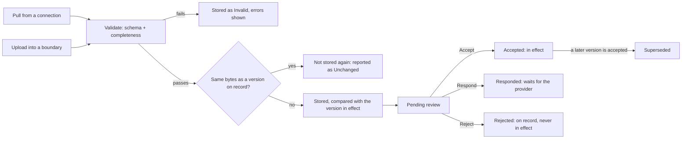

# User Guide: Connections and Received Documents

Take in FedRAMP, OSCAL, HDF and XCCDF documents from another system, or from a
person's upload, and decide each version before it counts. SPARC keeps every
version it receives, checks each one against its schema and for completeness,
shows what changed since the version in effect, and lets a reviewer of the
receiving boundary accept, respond or reject it (v1.17.11, #1354).

**Who this is for:** administrators who register the systems SPARC pulls from
(**Connections**), and the boundary's ISSOs, ISSMs and Authorizing Officials
who upload and review what arrives (**Received documents**). The permission
detail is on [RBAC](RBAC).

---

## Before you start

- **Access:**
  - **Connections** need an Instance Admin, or a role holding the instance-wide
    `connections.manage`.
  - Reading a boundary's **Received documents** needs `evidence.read` on the
    boundary; uploading needs `exchange.upload`; accepting, responding or
    rejecting needs `exchange.review`. The seeds grant `exchange.upload` to every
    role that holds `evidence.write`, and `exchange.review` to every role that
    holds `amendment.approve`.
- **Prerequisites:** the boundary the documents belong to.
- **Where to find it:**
  - **Connections:** your account menu → **Administration → Connections** (next
    to Roles), or the left sidebar's **Settings → Connections**. Both are shown
    only to someone the screen admits.
  - **Received documents:** the boundary's page → the **Evidence** section →
    **Received documents**. A connection's page also links to the boundary's
    received documents.

---

## At a glance

---

## 1. Register a connection

A connection is another system that publishes FedRAMP, OSCAL, HDF or XCCDF
documents, usually a provider's trust center.

1. Open **Connections** and choose **New Connection**.
2. Fill in **who** it is:
   - **Name**: how you will recognise it.
   - **FedRAMP ID**: the provider's FedRAMP Marketplace ID (F or FR and ten
     digits, e.g. `FR2401234567`). Optional.
   - **Certification class** (A–D) and **type** (20x or Rev5). Optional.
3. Fill in **where**:
   - **Boundary**: every document this connection delivers is received into
     this boundary and reviewed there.
   - **Root trust-center address**: the provider's trust-center page, HTTPS
     only. **Discover** reads it (see below).
4. Say **how SPARC signs in there**: **None**, a **Bearer token**, or a token in
   a **Named header** (give the header name, e.g. `X-Api-Key`). The token is
   stored encrypted and **never shown again**: the screens only say whether a
   credential is *set* or *not set*. Leave the field blank on edit to keep the
   stored token, type a new one to replace it, or tick **Remove the stored
   credential**.
5. Set the **trust pins** (next section), leave **Enabled** on, and choose
   **Create Connection**.

### Trust pins

SPARC reaches only what you registered, and nothing a fetched document points
it at:

- **Hosts.** SPARC connects only to the hosts of the addresses registered on the
  connection (the root address and each document's address). They are listed as
  **Pinned hosts** on the connection's page.
- **TLS public-key SHA-256.** Up to two values, one per line: the provider's
  current key and the next one, so it can rotate without an outage. The key is
  checked during the TLS handshake. Blank trusts the certificate authority alone.
- **IP ranges.** Optional. When set, the host must resolve inside one of them.

Whatever the pins say, SPARC uses HTTPS only, refuses private, loopback,
link-local and cloud-metadata addresses (unless they are inside the
connection's own IP ranges), never follows a redirect, and caps the size and
time of every fetch.

---

## 2. Choose the documents to pull

Only documents set on the connection are pulled. On the connection's page,
**Documents pulled** lists them, each with its schedule, its last pull (status,
time and any error) and the SHA-256 of the last version fetched.

- **Add a document:** give its address (HTTPS, on the provider's host), its
  format, optionally its document type (detected when blank), and how often to
  pull it (every 1 to 744 hours; 24 by default).
- **Discover** reads the root trust-center address and lists the document links
  on it that SPARC may reach. **Nothing is pulled and nothing is added**: each
  link has an **Add** button, pre-filled, for the ones this connection should
  pull. Links already on the connection are marked.
- **Edit** or **Remove** a document from its row. Removing one stops it being
  pulled; the versions already received stay on the boundary.

---

## 3. Pull now, scheduled pulls and Test connection

- **Scheduled pulls:** SPARC checks every hour and pulls each enabled document
  of an enabled connection whose own interval has passed.
- **Pull now** pulls every enabled document of the connection straight away and
  says what happened to each: a new version stored, unchanged, or failed with
  the reason.
- Every pull, scheduled or not, is recorded on the document and the connection
  (**Last pull**, its status and the error), and in the audit log, so a pull
  that failed overnight is visible the next morning.
- **Test connection** fetches the root address and each registered document
  exactly as a pull would, and validates each document, but **stores nothing**:
  no version, and nothing on the connection. Use it after setting up the pins to
  see that SPARC can reach the provider and that what it serves is valid.

---

## 4. Upload a document into a boundary

FedRAMP packages, OSCAL, HDF and XCCDF documents can also be dropped straight
into a boundary, like other artifacts.

1. Open the boundary's **Received documents** page.
2. Drag the file onto **Upload a document**, or click to browse.
3. Leave **Format** and **FedRAMP document type** on *Detect from the document*,
   unless SPARC cannot tell: a FedRAMP document without a `$schema` that names
   its schema may need its type.
4. Choose **Upload**. SPARC opens the version it stored.

An upload goes through exactly the same steps as a pull, with you recorded as
the person who uploaded it.

---

## 5. How every document is checked

Each document, pulled or uploaded, passes two checks against the schema SPARC
pins for its format (see [Integrations](Integrations)):

1. it matches its schema, and
2. every field the schema requires is **filled in**, not just present.

A version's page shows the result under **Validation**: each **error** with the
check that found it, where in the document (a JSON Pointer), and the message.
FedRAMP packages also get a **warning** for each optional field left empty;
warnings are shown and never block acceptance.

**A document that fails is still stored**, as **Invalid**, with its errors on
show, so the provider can be told exactly what to fix. An invalid version can
never be accepted; a valid version has to replace it.

A file SPARC cannot read as any of the four formats at all is not stored, and
the upload says why.

---

## 6. Versions, streams and states

SPARC never overwrites a version: its bytes, SHA-256, size, format and where it
came from are fixed when it is stored. Only its review changes afterwards.

Versions are grouped into **streams**: one per document address of a
connection, and, for uploads, one per format and document type in the
boundary. Each stream has at most one version **in effect**. The Received
documents page lists the streams, newest first, and each stream's versions,
newest first.

| State | What it means |
|---|---|
| **Pending review** | Stored and valid; waiting for a reviewer. Not in effect. |
| **Accepted** | In effect for its stream: the boundary's document of that type. |
| **Responded** | The reviewer asked the provider for information. Still not in effect; the version in effect stays in effect. |
| **Rejected** | On record, never in effect. |
| **Superseded** | Was accepted; a later version of the stream replaced it. |
| **Invalid** | Failed validation; on record with its errors, can never be accepted. |

### What changed

Each valid version is compared with the version in effect when it arrived, and
every change is classed:

- **Regression:** a new failure, a new vulnerability, an implementation status
  moving down, a required field going blank, or a class change.
- **Improvement:** the reverse of each of those.
- **Neutral:** anything else that changed.

Comparison is by the document's own keys: HDF requirements by id; OSCAL
implemented requirements and statements by control id and UUID; FedRAMP items
by their keys (a VDR by `providerTrackingId`, an SDR by `frrID`, `ksiId` or
`controlId`, an OCR by section); XCCDF rule results by rule id. The version's
page lists the changes, **regressions first**, then improvements, then neutral,
each with its summary and its before and after values. A stream's first version
has nothing to compare with, so everything in it is new.

### Which versions need a person

**Every new version waits for a reviewer**: a stream's first version, and any
version that differs from the one before it in any way, improvements included.

The only thing that does not need a person is a **byte-identical re-delivery**:
a pull or upload whose SHA-256 matches a version the stream already holds. It is
not stored again; the pull or upload is reported as **Unchanged**, and the
version in effect stays in effect.

---

## 7. Review a version

Open the version from the Received documents page. Someone holding
`exchange.review` on the boundary sees the **Review** card:

- **Accept** (optional note): the version takes effect for its stream, and the
  version it replaces becomes **Superseded**.
- **Respond** (note required: what you need from the provider): the version
  stays pending as **Responded**, and the version in effect stays in effect.
- **Reject** (note required: why): the version stays on record and never takes
  effect.

Every decision is recorded with who made it, when, and the note, and shows in
the version's **History** and the audit log.

### Separation of duties

The person who uploaded a version **cannot accept, respond to or reject it**,
even when they hold `exchange.review`: the Review card tells them someone else
has to review it, and SPARC refuses the decision if it is attempted anyway.
Pulled versions have no uploader. Instance Admins are exempt (break-glass), as
elsewhere in SPARC.

### What accepting does

A document belongs to the boundary only once the boundary accepts it. The
accepted version of each stream is the boundary's document of that type.

- An accepted **HDF** document also goes through the same ingest as an HDF
  upload on [HDF Amendment Triage](User-Guide-HDF-Amendment-Triage): its results
  become the boundary's scanner findings. If that ingest fails, the acceptance
  fails and the version stays pending.
- Bringing OSCAL, FedRAMP and XCCDF content into SPARC's own SSP, SAR and POA&M
  records is later work; for now the accepted version is held, listed and
  served as the boundary's document.

**Download** on a version's page returns its exact stored bytes, and its
SHA-256 is shown so they can be checked.

---

## Over the API

Everything on these screens is also in the API (see
[API Reference](API-Reference)):

- `/api/v1/exchange_connections`: list, create, update, delete, plus `pull`,
  `discover` and `test_connection`, and each connection's `document_sources`.
- `/api/v1/authorization_boundaries/:id/received_documents`: list, show,
  upload, `file`, and the `accept`, `respond` and `reject` decisions.
- `POST /api/v1/document_validations` checks a document without storing it.

---

## Tips and gotchas

- **Nothing was pulled after Discover.** That is by design: Discover only lists
  links. Add the documents you want, then use **Pull now** or wait for the
  schedule.
- **A pull failed with a key or host error.** The provider's TLS key no longer
  matches a pin, or a document's address is on a host the connection does not
  pin. Check the pins with **Test connection** before changing them.
- **The same document again is "Unchanged".** A byte-identical re-delivery is
  never stored twice. Change nothing to keep the version in effect.
- **You uploaded it and cannot accept it.** Ask another reviewer of the
  boundary: separation of duties.
