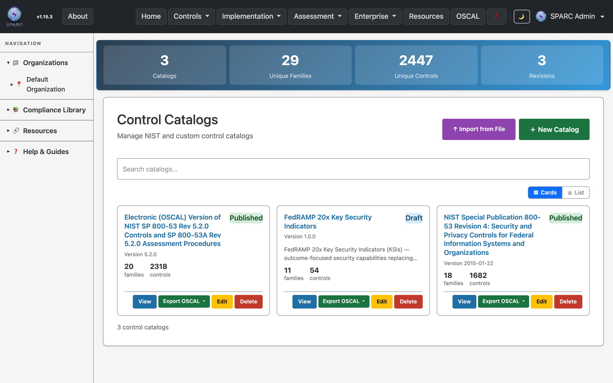
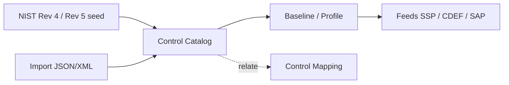
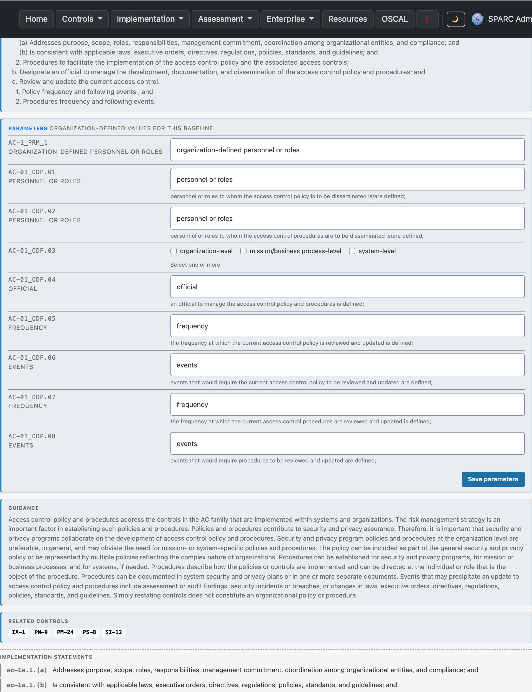

# User Guide: Control Catalogs & Baselines

The controls layer is the foundation everything else builds on. A **control
catalog** is the full set of controls from a source like NIST SP 800-53; a
**baseline** (also called a profile) is a tailored selection of those controls
for a given impact level or system. **Control mappings** relate one catalog's
controls to another's. This guide covers loading catalogs, tailoring baselines,
and building mappings.

**Who this is for:** control authors and compliance engineers. Viewing catalogs,
baselines, and mappings is public on most instances; creating and editing
requires the appropriate role — see [RBAC](RBAC).

---

## Before you start

- **Access:** viewing is typically public; creating/editing catalogs, baselines,
  and mappings requires a role with the matching write permission.
- **Where to find it:** the **Controls** menu → *Control Catalogs*
  (`/control_catalogs`), *Baselines* (`/profile_documents`), *Mappings*
  (`/control_mappings`).

---

*The Control Catalogs index — NIST catalogs and baselines available in the instance.*

## At a glance

---

## Primary use cases

- **Load a control catalog** from NIST seed data or by importing an OSCAL
  catalog file.
- **Tailor a baseline** — pick the subset of controls that applies to your
  system's impact level.
- **Map between frameworks** — relate controls in one catalog to another (e.g.
  Rev 4 → Rev 5) with NIST IR 8477 relationship types.

---

## Working with control catalogs

### How to create a catalog from NIST seed data

1. Go to *Controls → Control Catalogs* (`/control_catalogs`).
2. Click **New**.
3. Enter **name**, **version**, **source**, and **description**.
4. In the **template selector**, choose **NIST SP 800-53 Rev 4** or **Rev 5** to
   seed the catalog with that control set (or **blank** to start empty).
5. Save. Open the catalog to see its **control families**, each listing its
   controls.

### How to filter by framework

Catalog and baseline lists offer a **Framework** filter (for example *NIST SP
800-53* or *FedRAMP 20x*). The value is worked out when the document is
imported and stored on the record, so filtering is instant and does not depend
on how a title happens to be worded.

SPARC decides it from the strongest available signal, in order: an explicit
source on the catalog, then the shape of the control identifiers (`ksi-iam-elp`
is a FedRAMP 20x indicator, `ac-2` an 800-53 family), then the title, then the
filename. A baseline inherits from the catalog it was built from, so a baseline
named simply *Demo LOW Baseline* still filters correctly.

When nothing identifies the framework clearly, SPARC leaves it **unspecified**
rather than guessing — a wrong framework label on a compliance artifact is worse
than no label. If a document shows as unspecified and you know what it is, set
the value on the record and SPARC will not overwrite it on a later import.

---

### How to import a catalog

1. From the catalog list, click **Import** (`/control_catalogs/import`).
2. Upload a catalog file — an OSCAL catalog in **JSON, YAML or XML**. All three
   import the same way: an XML catalog is first checked against the OSCAL schema
   (a file that is not a valid OSCAL catalog is refused) and converted to the
   JSON model, so it keeps everything a JSON catalog keeps — parts, assessment
   objectives and methods, and each parameter's assigned **values**.
3. Submit. The catalog is created with its families and controls populated, as a
   **Draft**. Importing again into an existing catalog also returns it to Draft.
   Each top-level group in the file becomes a family. A group may hold further
   groups (OSCAL allows any depth, as in NIST's example catalog); their controls
   join the top-level group's family, and the family page shows each nested
   group as a heading over the controls it holds. A file whose groups hold no
   controls at any depth is refused, with that reason.
4. Review the **quality warnings** SPARC raises after the import: controls with
   no statement or no assessment objective, parameters a statement uses but the
   catalog never defines, and empty families. They are advisory. Correct what
   matters while the catalog is a Draft, then click **Revalidate** to refresh
   them.
5. Click **Publish**. The dialog lists any remaining warnings, and you can
   publish with them. When document approval is required
   (`SPARC_REQUIRE_DOCUMENT_APPROVAL`), the catalog must be submitted and
   approved first, like any other document. Publishing makes it read-only.

A catalog is not checked for control **priority** or **baseline impact**. Those
belong to a baseline (profile), which sets them for its own controls. NIST's
catalogs carry neither. The NIST catalogs SPARC seeds are already published.

### What the "Pre-release" badge on NIST SP 800-53 Rev 5 means

NIST has corrected three controls in SP 800-53 Rev 5 that its latest release
still gets wrong:

- **SA-15(13)** — the statement was SA-15(12)'s requirement, and its Examine
  method was labelled `SA-15(12)-Examine`;
- **SA-24** — assessment objectives b.[06]–b.[10] were missing, and six
  objectives pointed at AC-2's statement;
- **SI-02(07)** — objectives c.[01] and c.[02] had no labels.

The corrections are on NIST's `main` branch of oscal-content and in no NIST release yet.
SPARC's bundled Rev 5 catalog includes them, so it is marked **Pre-release** on
the catalog list and the catalog page, which names the NIST commit it was built
from. The catalog's own OSCAL metadata stays exactly as NIST wrote it. When NIST
releases the fixes, SPARC moves to the released catalog and the badge goes away.

An existing installation receives the three corrections automatically after the
upgrade (a background data migration, listed on the admin *Data Migrations* page). Only those
three controls change, and only where they still hold NIST's original text: if
someone in your organization edited one of them, the edit is kept and the log
names it. SSPs are never changed — the log lists any SSP whose SA-15(13)
statement still carries the old text, so its author can update it.

The API reports the same flag as `nist_pre_release` on each catalog.

### How to add your organization's own controls

Write them as an OSCAL catalog of their own, not as edits to a copy of NIST's.
An OSCAL profile can change an existing control but cannot add one, so a
baseline that mixes NIST and your controls is a profile importing both
catalogs.

Two skeletons to copy are in
[`docs/api/samples/`](https://github.com/risk-sentinel/sparc/tree/main/docs/api/samples):

- **`custom-controls-catalog.json`**: one family (`DP`), one control with a
  parameter, statement, guidance and assessment objectives, and one
  enhancement. Replace the Example values, keep a control-id prefix of your own
  so it never collides with a NIST family, and import it as above. It imports
  with no warnings.
- **`custom-controls-profile.json`**: a baseline that selects a few NIST Rev 5
  controls and the custom ones, and sets the custom parameter.

Both are valid OSCAL 1.2.3. Import your catalog first, then the baseline.

### How a baseline that imports several catalogs is linked

Each of a baseline's imports is matched to a loaded catalog on its own, whether
the baseline is OSCAL JSON, YAML or XML, by the first of these that fits:

1. the catalog's OSCAL UUID, in the import's `href` or its back-matter link;
2. for NIST, the SP 800-53 revision named in the back-matter link;
3. the back-matter resource's **title**, when exactly one loaded catalog has
   that name.

Every control records the catalog it came from, takes its title from that
catalog, and exports under that catalog's own import, so NIST's controls and
yours are never attributed to each other. The baseline's **source catalog** is
the first import that matched.

An import that matches nothing (its catalog is not loaded, or two catalogs share
its title) is left unlinked: its controls import without titles and the import
is listed on the baseline's page. Load the catalog, or give it a unique name,
and import the baseline again.

### Which controls an imported baseline selects

SPARC applies every OSCAL selection rule, against each import's own catalog, the
same way for JSON, YAML and XML:

| In the baseline file | What SPARC selects |
|---|---|
| `include-all` | every control in the catalog, enhancements included |
| `include-controls` → `with-ids` | the named controls, in the order listed |
| `include-controls` → `matching` | controls whose id matches the pattern (`*` any run of characters, `?` one character) |
| `with-child-controls: yes` | also every enhancement of each selected control |
| `exclude-controls` | the same selectors, removed after everything is included |

What the baseline page tells you:

- **This baseline names controls its catalog does not have.** An id the
  baseline lists by name is not in the catalog. A baseline can tailor a control
  but cannot add one, so fix the id or load the catalog that has it.
- **Not applied until the catalog is loaded.** On an unlinked import, the
  selectors that need the catalog (`include-all`, `matching`,
  `with-child-controls`) select nothing; only the ids it names are kept. Load
  the catalog and import the baseline again.

A baseline's **alters** are applied too: parts it **removes** (by id, name,
class, namespace or kind) and parts it **adds**, placed where it says. Open a
control's details on the baseline page to see **Tailored by this baseline**. The
resolved catalog, the requirement text an SSP author reads, and the response
rows a new SSP gets all follow the same tailoring. An SSP generated before the
baseline was imported keeps its rows.

### How to edit families and controls

- Open a catalog and drill into a **family** to see its controls; use **Edit**
  on the family to change its code, name, or description.
- **Edit** an individual control (`/catalog_controls/:id/edit`) to change its ID,
  title, description, or statement.
- In the same form, the **OSCAL Parameters** table has a **Value** column: the
  value the catalog itself assigns to an organization-defined parameter. Type it
  for an ordinary parameter (separate several values with `|`); for a selection,
  pick from its choices — a value that is not one of the choices is refused and
  nothing is saved. Leave it empty to assign nothing. The catalog's value is used
  wherever a baseline or SSP sets none; a value a baseline sets still wins.
- The parameter's **Label** is shown read-only beside it. It describes the
  parameter ("frequency", "personnel or roles"). Before v1.17.2 the form edited
  the label, so a value typed there was stored as a label; those labels are left
  as they are, and you can copy one across into **Value**.
- To add many controls at once, use **Batch Create** on a family
  (`.../catalog_controls/batch_new`) — fill multiple rows and submit together.

### How to export a catalog

On the catalog detail page use the **OSCAL** export buttons. Two variants are
offered: **validated** (schema-checked) and **unvalidated**. An imported catalog
exports its groups as the file had them, nested groups included.

### What a "Retired" badge means

Some sources withdraw entries. The FedRAMP 20x KSI catalog is built from
FedRAMP's published rules, and when FedRAMP drops or renames an indicator,
SPARC **retires** the old one rather than deleting it, so the assessments
recorded against it are kept.

- On the catalog page a retired family shows a **Retired** badge. A family's
  count is its current controls, with any retired ones listed as `+N retired`.
- On a family page a retired control shows a **Retired** badge and, where the
  source names one, the entry that **superseded** it. That is the source's
  pointer to the closest successor; it does not mean an assessment carries over.
- The OSCAL export marks a retired entry `withdrawn`, the way NIST marks a
  withdrawn 800-53 control.
- Today only the FedRAMP 20x KSI catalog retires entries. Baselines, profiles
  and assessment plans are built from NIST catalogs and do not take retirement
  into account.

---

## Working with baselines (profiles)

A baseline selects and prioritizes controls from a catalog.

### How to create a baseline from a catalog

1. Go to *Controls → Baselines* (`/profile_documents`).
2. Click **Create from Catalog** (`/profile_documents/select_catalog`).
3. **Step 1:** choose the source catalog.
4. **Step 2:** use the checklist to select which controls to include.
5. Submit to create the baseline. Its detail page shows the selected controls
   with a **priority heatmap** grouped by NIST family.

You can also click **Create New** for an empty baseline, or **Copy** an existing
baseline's detail page to duplicate it as a starting point.

### How to link an imported baseline to its source catalog

A baseline created with **Create from Catalog** is linked to that catalog
automatically. An **imported** baseline is not — the file may name a catalog
SPARC has not loaded, or you may have imported the baseline first. Until it is
linked, SPARC has nothing to resolve the baseline's controls against, so
**Manage Controls** and **Publish** do not appear on its detail page.

An unlinked baseline says so in its header: **No source catalog**.

To link it:

1. Open the baseline (*Controls → Baselines*, then the baseline's name).
2. In the **source catalog** panel near the top of the page, choose the catalog
   the baseline draws its controls from.
3. Click **Link catalog**.

**Manage Controls** and the publish flow appear once it is linked.

Two things to know:

- **Nothing is invented for you.** If no suitable catalog is loaded, SPARC says
  so rather than building one from the baseline's own controls — that would
  check the document against itself. Import the correct catalog first, then come
  back and link it.
- **Choose carefully before publishing.** While the baseline is in draft you can
  change the catalog at any time (the button reads **Change catalog**). Once the
  baseline is **published** its catalog is fixed, because assessments made
  against it are only meaningful relative to the baseline they were made
  against. To point a published baseline at a different catalog, make an
  editable copy.

API equivalent: `PATCH /api/v1/profile_documents/:id` with
`{ "profile_document": { "control_catalog_id": <id> } }`.

### How to start a new version of a published baseline

A published baseline is read-only. To tailor it further, work on a copy:

1. Open the published baseline and choose **Create Editable Copy**. The copy is
   named "Copy of …" and starts unpublished.
2. Choose **Edit** beside the copy's name, give it its own name and version
   number, and **Save**. The page's address follows the new name.
3. Tailor the copy: parameters, controls, priorities. Publish it when it is
   ready.

The **OSCAL Metadata** section further down the page sets the OSCAL version,
published date and description.

API equivalent: `PATCH /api/v1/profile_documents/:id` with
`{ "profile_document": { "name": "…", "profile_version": "…" } }`.

### How to set control priorities

Open a baseline, then **Edit** an individual profile control
(`/profile_documents/:id/profile_controls/:id/edit`) to set its **priority**.
The priority heatmap on the detail page reflects your selections.

### How to read what a baseline requires

Open a baseline and expand a control's **What this baseline requires** panel.
It shows, for that control:

- the **control statement** — the actual requirement language, with this
  baseline's parameter values substituted into it
- the **parameters** (organization-defined values, or ODPs) the control
  defines, and what this baseline has set for each
- the **priority** the baseline assigns
- the **guidance** from the source catalog
- the **related controls**
- the **implementation statements** — the lettered sub-parts of the requirement
  (`ac-1a`, `ac-1a.1`, …), each with the baseline's parameter values substituted

You never see raw OSCAL markup such as `{{ insert: param, ac-20_odp.01 }}` —
the values are substituted before the page renders, so what you read is what
the baseline actually asserts. A parameter the baseline has not set but the
catalog assigns shows the catalog's value, marked *"the catalog's value"*. A
parameter nobody has set reads *"Not set — the baseline default applies"* rather
than being hidden.

The same panel appears on an SSP's controls, where it is **read-only**: an SSP
consumes the baseline, it does not define it.

### How to tailor a baseline's parameters

Tailoring means answering the organization-defined values a control leaves
open — "lock the account after **N** unsuccessful attempts", "review the policy
**every N months**".

1. Open the baseline (it must not be published — publish freezes it).
2. Expand a control's **What this baseline requires** panel.
3. Type the value into the parameter's box, or tick the choices for a
   selection.
4. **Save parameters**.

The screen returns to that control with the new value in place, substituted
into the control statement. If the value cannot be applied — an id the catalog
does not define, or a selection sent in the wrong shape — the page says which
one and why, and nothing is written.

You need the **profiles.write** permission ([RBAC](RBAC)). Without it you still
see every value; you simply have no boxes to change them in.

API equivalent: `PUT /api/v1/profile_documents/:id/parameters`, and
`GET .../parameters` to read the whole schema. Bulk ODP files can be uploaded
through `POST .../parameters/import/preview` and `.../import/confirm`.

To tailor a whole NIST Rev 5 baseline at once, start from a worksheet:
[`docs/api/samples/`](https://github.com/risk-sentinel/sparc/tree/main/docs/api/samples)
holds one for the full Rev 5 catalog and one each for the LOW, MODERATE and
HIGH baselines, listing every parameter and selection with NIST's guidance and
the allowed choices. Fill in the values you have decided and send the file as
it is to either endpoint above; entries you leave `null` are skipped, so they
do not overwrite anything. Rev 5 parameter ids look like `ac-01_odp.03`; the
older `ac-1_prm_2` form NIST kept alongside each one is accepted too. See the
[Baseline Parameters API](https://github.com/risk-sentinel/sparc/blob/main/docs/api/endpoints/baseline-parameters.md).

### How to export a baseline

On the baseline detail page: **JSON** for the raw document, or **OSCAL**
(validated / unvalidated) for the profile.

**Resolved Catalog** exports the baseline as a conformant OSCAL *resolved
profile catalog* — the shape NIST publishes for its own baselines. Control
enhancements are nested inside their parent control (`ac-2` contains `ac-2.1`,
`ac-2.2`, …) rather than listed beside it, and each control carries its links
back to the reference material in the document's back-matter.

---

## Working with control mappings

### How to build a mapping between two catalogs

1. Go to *Controls → Mappings* (`/control_mappings`) and click **Create New**.
2. Give the mapping a **name** and set its **source** and **target** catalogs.
3. Open the mapping detail page. In the **Add Entry** row, enter the **source
   control ID**, **target control ID**, their types, and a **relationship**,
   then click **Add Entry**. Relationship types (per NIST IR 8477) are:
   **equal**, **equivalent**, **subset**, **superset**, **intersects**.
4. Repeat for each pair. Entries appear in the **Mapping Entries** table.

### How to publish or deprecate a mapping

Use the action buttons on the mapping detail page: **Publish** moves a draft to
complete; **Deprecate** retires a completed mapping. **Export OSCAL** emits the
mapping in OSCAL form.

---

## Tips & best practices

- Seed from **NIST Rev 5** unless you have a specific reason to stay on Rev 4 —
  it's the current FedRAMP baseline.
- Build the **baseline once, reuse it** across every SSP for that impact level
  rather than re-selecting controls each time.
- Keep a mapping in **draft** until every entry is reviewed, then **Publish** —
  downstream consumers should rely on published mappings.
- Prefer **import** for authoritative OSCAL catalogs and **seed** for the
  standard NIST sets; hand-editing is best reserved for small corrections.

---

## Troubleshooting

| Symptom | Likely cause | What to do |
|---|---|---|
| Import rejected | File isn't valid OSCAL JSON/YAML/XML (an XML catalog is checked against the OSCAL schema first) | Validate the catalog file before importing |
| "Parameter values were not saved" when editing a control | A selection's value is not one of its choices | Pick one of the listed choices, or leave the value empty |
| OSCAL export fails validation | Missing required metadata on a control | Fix the flagged fields, then use the validated export |
| Can't add a mapping entry / edit a control | View-only access | You need the write permission ([RBAC](RBAC)) |
| Baseline shows no controls | None selected in the checklist step | Re-run **Create from Catalog** and select controls |
| No **Publish** or **Manage Controls** button on a baseline | It has no source catalog — the header shows **No source catalog** | [Link it to a catalog](#how-to-link-an-imported-baseline-to-its-source-catalog) |
| Can't change a published baseline's catalog | Published baselines have a fixed catalog, so assessments stay meaningful | Create an editable copy, then link the copy |
| A control shows **Details** instead of **What this baseline requires** | The linked catalog has no statement, parameters or guidance for it | Check the control in the catalog; an imported catalog may carry identifiers only |
| No **Save parameters** button, but the values are visible | You have read access, not `profiles.write` | Ask an administrator ([RBAC](RBAC)) |
| Parameters can be read but not changed on a baseline you may write | The baseline is published | Create an editable copy and tailor that |
| **Related Controls** is empty on every control | The catalog predates the fix that reads control-level links | Re-import the catalog |

---

## Finding what you need

The catalogs, baselines and mappings list opens as **cards**, with a **☰ List** toggle if you prefer a
table. Your choice is remembered for this screen.

Catalogs filter by **OSCAL version**, **revision**, **source** and **status**.
Baselines add **baseline level** (Low / Moderate / High), **source catalog**,
**added by** and a **created between** date range.

Note that *revision* and *OSCAL version* are different things: revision is the
catalog's own version (Rev 4, Rev 5, 5.2.0), while OSCAL version is the schema
the file was written against. A single package legitimately contains documents
written against several OSCAL versions, which is why both are offered.

See [Browsing a list of documents](User-Guide-Getting-Oriented#browsing-a-list-of-documents) for how cards, lists, search and filters work — they behave the same on every list screen.

---

## Related guides

- [User Guides index](User-Guides)
- [Converters & Imports](User-Guide-Converters-and-Imports)
- [System Security Plans (SSP)](User-Guide-System-Security-Plans) — consumes
  baselines.
- [Framework Mapping](Framework-Mapping) — how external frameworks relate to NIST.
- [Screens & UI](Screens) — exhaustive element-level reference.
