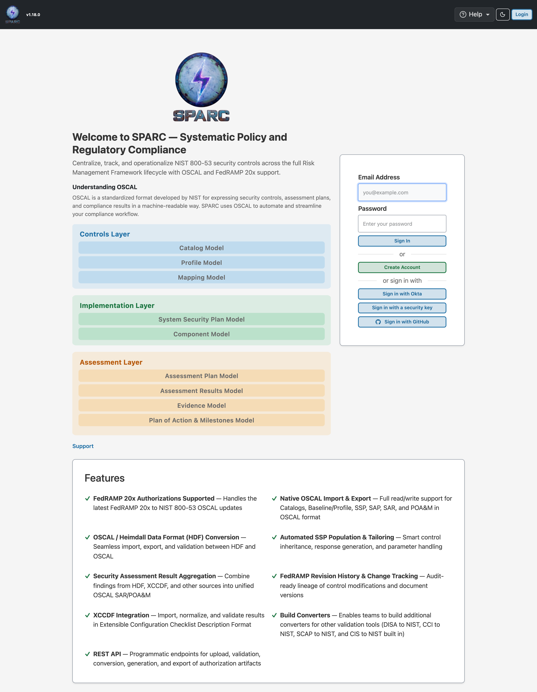
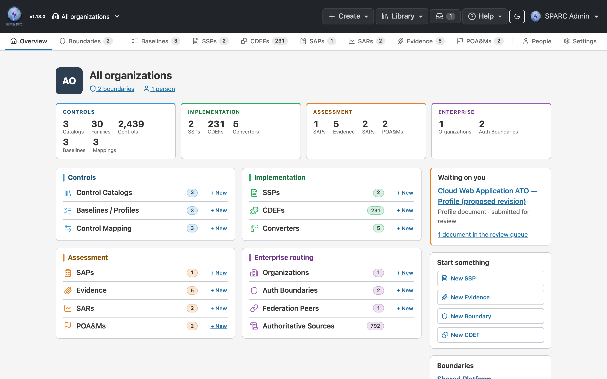
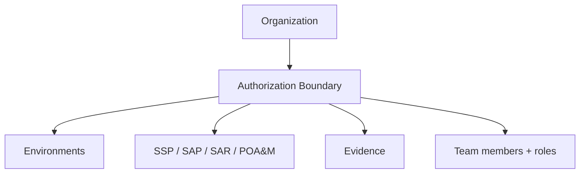

# User Guide: Getting Oriented

A tour of the SPARC interface: how to sign in, read the Overview, move around
with the header and tabs, and understand how your work is organized. Read this
first if you are new to the application.

**Who this is for:** every user. No special role is required to sign in and view
the Overview; what you can create or edit depends on your assigned roles — see
[RBAC](RBAC).

---

## Before you start

- **Access:** an account on your SPARC instance. Depending on how the instance
  is configured you may sign in with a local email/password, an SSO provider
  (Okta/OIDC, GitHub, GitLab), or LDAP.
- **Where to find it:** the application URL for your instance. If you are running
  SPARC yourself, follow [Getting Started](Getting-Started) first.

---

## Signing in

*The Login page — the authentication tabs shown depend on what the instance has enabled.*

1. Open your SPARC instance. If you are not signed in you land on the **Login**
   page (`/login`).
2. Pick the tab for your authentication method — **Local Login**, **OIDC/SSO**,
   or **LDAP** — or use a **GitHub**/**GitLab** button if shown. The tabs that
   appear depend on what the instance has enabled.
3. Enter your credentials and sign in. First-time local accounts created by an
   admin may be prompted to change the password on first login.

The login page also shows an **OSCAL overview** panel explaining the document
model. After you sign in, the same content is at **Help → OSCAL overview**
(`/oscal-overview`).

---

## The page layout

Every page has the same frame:

1. **The header** — one dark row across the top. It shows where you are and
   holds the menus.
2. **The tab bar** — a row of tabs under the header. It lists the kinds of
   records you can open.
3. **The page** — the screen you opened.

There is no left sidebar. Everything it used to hold is now in the header or
the tabs.

---

## The header

From left to right, the header holds:

| Item | What it does |
|---|---|
| **SPARC logo and version** | Shows which release you are running. |
| **Where you are** | Your organization's name, then the boundary's name when the page is inside a boundary. Click the organization to go to the **Overview**. Click the boundary to open its page. |
| **Boundary switcher** (the arrow beside the names) | Jumps to another boundary. See below. |
| **Create** (plus icon) | Starts a new Boundary, Baseline, SSP, CDEF, SAP, SAR, Evidence record or POA&M. |
| **Library** | The shared library: Control Catalogs, Baselines, Mappings, Component Definitions, Converters, Authoritative Sources, Promotion Queue, Leveraged POA&Ms and Federation Peers. |
| **Review queue** (inbox icon) | The documents waiting for your approval, with a count. |
| **Help** | Help for this page, the guides, and About SPARC. |
| **Theme toggle** | Switches between light and dark. |
| **Account menu** (your avatar or initials) | Profile, Change Password, Security Keys and Sign Out. |

Each menu lists only what you are allowed to open or create. If you can create
nothing, there is no **Create** menu. The **Review queue** icon appears only if
you approve documents.

On a narrow screen the menu names hide and only the icons show.

### The boundary switcher

Click the small arrow beside the organization or boundary name to open the
switcher. It lists every boundary you can reach:

- **All boundaries** is at the top.
- **Recently used** boundaries come next.
- The rest are grouped by organization. If all of your boundaries are in one
  organization, they appear as one list.

Type in the **Filter boundaries…** box to narrow the list. Press **Esc** to
close it.

What happens when you pick a boundary depends on the page:

- **On a list** (for example, the SSPs list), you stay on that list. It now
  shows only that boundary's records.
- **Anywhere else**, the boundary's own page opens.

Pick **All boundaries** to go back to records from every boundary.

### The Create menu

**Create** starts a new record. When you are inside a boundary, the menu reads
**Create in** *boundary name*. A new SSP, SAP, SAR, Evidence record or POA&M
then starts with that boundary already chosen.

### The Help menu

- **Help for this page** opens the guide for the screen you are on, in a
  drawer over the page. The form underneath stays visible, and anything you
  typed is left alone. Press **Esc** to close the drawer. Use **Open full
  guide** inside it to read the whole guide in a new tab.
- **Guides** lists **Getting Oriented**, the **Help Center** and every other
  guide.
- **About SPARC** holds **About**, **Resources** and **OSCAL overview**, plus
  any reference links your operator added.

See [User Guides](User-Guides) for more on the in-app guides.

### The account menu

Your avatar (or initials) is at the right end of the header. Its menu holds
**Profile**, **Change Password**, **Security Keys** (when the instance has
them turned on) and **Sign Out**. Instance Admins also see an
**Administration** list there, with the same screens as **Settings**.

---

## The tabs

The tab bar changes depending on where you are.

### Organization tabs

Outside a boundary you see the organization tabs:

**Overview** · **Boundaries** · **Baselines** · **SSPs** · **CDEFs** ·
**SAPs** · **SARs** · **Evidence** · **POA&Ms** · **People** · **Settings**

- **Overview** is the home page.
- **Boundaries** lists the authorization boundaries you can see.
- The document tabs show a count. The count is coloured by layer: blue for
  Controls, green for Implementation, orange for Assessment, purple for
  Enterprise.
- **Baselines** and **CDEFs** appear when the shared library is open to you.
- **People** (the Users screen) and **Settings** appear for Instance Admins
  only.

### Boundary tabs

Inside a boundary — on its page, or on a list narrowed to it — the tabs belong
to that boundary:

**Overview** · **Baseline** · **SSP** · **CDEFs** · **SAPs** · **SARs** ·
**Evidence** · **POA&Ms** · **Leveraged POA&Ms**

- **Overview** is the boundary's own page.
- **Baseline** opens the boundary's baseline. It appears only when the
  boundary has one.
- Every other tab opens a list that shows only this boundary's records.

To leave the boundary, click the organization name in the header, or pick
**All boundaries** in the switcher.

---

## The Overview (home page)

*The Overview — counts by layer, a card per layer, and a rail of things to do.*

After you sign in you land on the **Overview** (`/`). It has four parts.

**1. The organization header.** Your organization's name, how many boundaries
you can see, and (when you may see it) how many people it has. Each number
links to its list. If you
belong to several organizations, or none, it reads **All organizations**.

**2. The inventory.** Four cards, one per layer — Controls, Implementation,
Assessment and Enterprise. Each card shows the counts for its layer. Controls
also shows how many control families and controls the loaded catalogs hold.
Every count is a link to its list.

**3. The layer cards.** One card per layer, with one row per screen. Each row
shows the screen's name, its count, and **+ New** when you may create one.

- **The count** is how many records that screen holds **that you can see**.
  SSPs, SAPs, SARs, Evidence, POA&Ms and Auth Boundaries count only the
  boundaries you have access to. (Evidence also counts instance-wide evidence,
  which belongs to no boundary.) The shared library (catalogs, baselines,
  mappings, CDEFs, converters) counts everything. Instance Admins see the whole
  instance.
- **Organizations** is an administrator screen, so its row appears only for
  Instance Admins.

**4. The rail** on the right:

- **Waiting on you** — documents waiting for your review. Approvers only.
- **Start something** — quick links to a new SSP, Evidence record, Boundary or
  CDEF. Only the ones you may create appear.
- **Boundaries** — your recently updated boundaries, each with a small chart
  of its recent activity, and **View all boundaries**.
- **Baselines in use** — the baselines your boundaries use, and how many use
  each.
- **Help** — a support contact, when your operator has set one.

---

## Settings (Instance Admins)

The **Settings** tab opens the administration page. It lists every admin
screen in three groups, with a line on what each one is for:

| Group | Screens |
|---|---|
| **Access** | Users, Roles, Service accounts, Unmatched IdP grants |
| **Organization** | Organizations, Authorization boundaries, Remediation timelines |
| **Records** | Audit log, Catalog lineage, Data migrations |

Every admin screen shows the same menu down its left side, so you can move
between them in one click. On a phone the menu sits above the screen.

See [Administration](User-Guide-Administration) for the tasks on each screen.

---

## Browsing a list of documents

Every list screen in SPARC — SSPs, assessments, POA&Ms, component definitions,
catalogs, evidence, converters, boundaries, the queues — works the same way. Learn
it once and it applies everywhere.

*A collection screen in card view. Search sits at the top, any active filters
appear as removable chips beneath it, and the view toggle is on the right.*

### How a list screen is laid out

Open a list from a tab (for example **SSPs**) or from the **Library** menu.
From top to bottom you see:

- **Status tabs**, on some lists. Each tab names a status and shows a count.
  Click one to show only the records in that status.
- **The search box.**
- **Filter chips** — what is narrowing the list right now.
- **The Cards / List toggle**, on the right.
- **The records**, then the page links.

Most document lists also have a **left column**. It holds the **Boundary**
filter — **All boundaries**, then each boundary you can reach, with a count —
and the list's other filters. On a phone the column sits above the list.
Picking a boundary there does the same thing as picking it in the header's
boundary switcher.

### Cards or a list — your choice, remembered

Each screen opens as **cards** by default. A card shows enough to choose between
items without opening them: what the item is, what state it's in, and how big it
is. Use the **▦ Cards / ☰ List** toggle on the right to switch to a table, which
is easier for scanning a long run of items or comparing a single column.

Your choice is remembered **per screen**, so you can keep SSPs as a list and
component definitions as cards. It sticks for a year, in that browser.

The choice also travels in the address bar. If you send someone a link while
you're in list view, they see the list — the link shows them what you were
looking at, and it does **not** change their own saved preference for that screen.

Every action available in one view is available in the other. Nothing is hidden
by choosing cards.

### Searching

The search box narrows the list as you type. What it matches depends on the
screen and is usually broader than the name: a component definition also matches
on its AWS regions, control IDs, capabilities and automated-check IDs, so
`us-east` or `AC-2` finds things the name alone never would. A converter matches
on the frameworks it translates between; a federation peer on its URL.

Searching never changes your card/list choice, and it keeps any filters you have
already applied.

### Filters

Most list screens offer filters as well as search. What each one offers depends
on the screen:

| Screen | Filters |
|---|---|
| Control catalogs | OSCAL version · revision · source · status |
| Baselines (profiles) | baseline level · OSCAL version · revision · status · source catalog · added by · created between |
| POA&Ms | status · OSCAL version · revision · authorization boundary · added by · created between |
| Evidence | type · status · source · control · authorization boundary · collected between |
| Component definitions | cloud partition · capability · whether they carry automated checks |
| Authoritative sources | scope · rel · media type |

Two things about those lists are worth knowing:

- **The choices come from your data, not a fixed list.** The OSCAL version
  dropdown offers the versions your documents actually use. As you import
  documents written against newer OSCAL releases, they appear on their own.
- **A filter you couldn't use isn't shown.** If every catalog you hold uses the
  same OSCAL version, there is nothing to choose between, so that filter is
  hidden rather than offered as a dropdown with one entry.

Filters and search **narrow together**, they don't replace each other. Searching
`iam` with the GovCloud filter on means "IAM, in GovCloud".

Applying a filter keeps everything else about how you were looking at the list —
your search, your card/list choice and your page size. It does return you to the
first page, because the page you were on describes a different set of results.

Whatever is currently narrowing the list appears as a row of chips above it, with
a count — *"3 filters active"*. Each chip removes just that one filter and leaves
the rest; **Clear all** removes them all but keeps your card/list choice, because
that's how the list is drawn, not which items are in it. The search term appears
as a chip too, so a short list is never unexplained.

When nothing matches, the screen says so — *"No component definitions match the
current filters."* — rather than simply appearing empty.

### Paging

Long collections are paged, with the count shown underneath ("1–24 of 331"). Page
links carry your search, filters and view mode with them, so paging never loses
your place in a filtered set.

---

## How your work is organized

Everything in SPARC lives inside a hierarchy. Understanding it explains why you
see some documents and not others.

- **Organization** — the top-level tenant. Larger instances have several.
- **Authorization Boundary** — the system undergoing authorization (roughly one
  ATO). Documents, environments, and team membership all attach here. This is
  the unit that data access is scoped to (see [Data Isolation](Data-Isolation)).
- **Documents & evidence** — the SSP/SAP/SAR/POA&M and evidence for that
  boundary.

Your **roles** determine what you can do within a boundary and across the
instance. A quick mental model:

- **Instance Admin** — manages users, roles, and instance-wide settings.
- **Boundary roles** — scoped to a single boundary (e.g. author, reviewer,
  approver).

See [RBAC](RBAC) for the full role and permission matrix.

---

## Tips & best practices

- To work through one boundary's documents, pick it in the **boundary
  switcher**. The **boundary tabs** then keep every list narrowed to it.
- Use the **organization tabs** to compare records across all your boundaries.
- Use **Help → Help for this page** to check what a field means without
  leaving the form.
- Set the **theme** once; it is remembered per browser via local storage.
- Can't see a menu, tab or document? It's almost always a **role/scope** issue,
  not a bug — check your roles on the relevant boundary in [RBAC](RBAC).

---

## Troubleshooting

| Symptom | Likely cause | What to do |
|---|---|---|
| No login tabs / "no auth configured" message | Instance has no auth method enabled | An admin must enable one (see `ENVIRONMENT_VARIABLES.md` / [Configuration](Configuration)) |
| No tabs, no **Create** menu, no boundary switcher | Not signed in | Sign in; these require authentication |
| A **Create** item is missing | You lack the role to create that record | Ask an admin to grant the role ([RBAC](RBAC)) |
| A boundary or document isn't visible | Not a member of that boundary, or lacking the role | Ask an admin to add you / grant the role ([RBAC](RBAC)) |
| No **Review queue** icon | You don't approve documents | Expected — only approvers see it |
| No **People** or **Settings** tab, no **Administration** in the account menu | You are not an Instance Admin | Expected — only Instance Admins see them |

---

## Related guides

- [User Guides index](User-Guides)
- [Authorization Boundaries](User-Guide-Authorization-Boundaries)
- [Administration](User-Guide-Administration)
- [Getting Started](Getting-Started) — install, seed, and first login.
- [Screens & UI](Screens) — exhaustive element-level reference.
